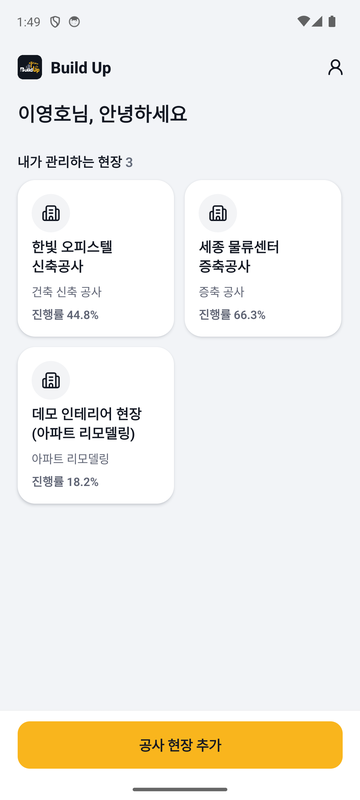
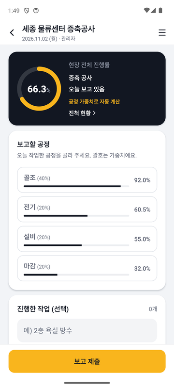
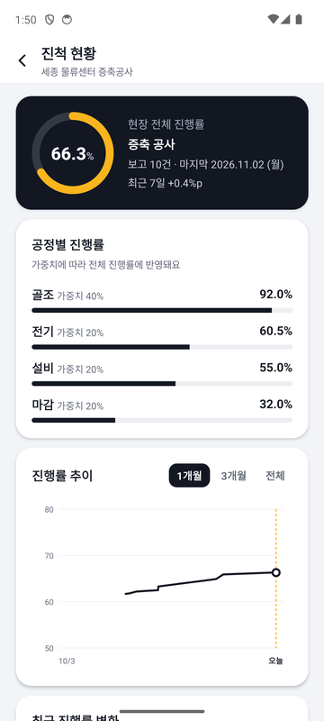
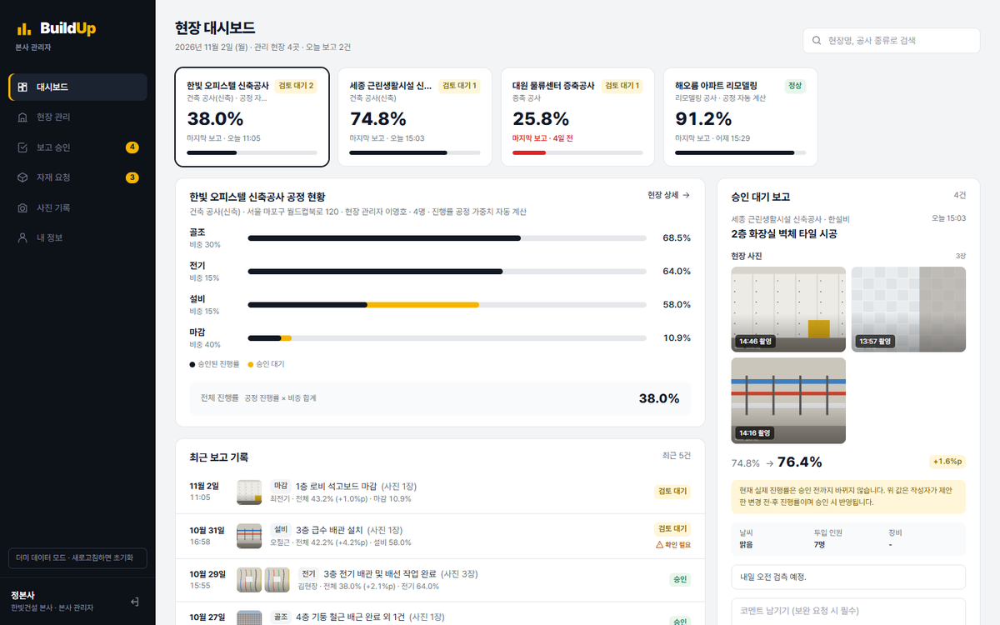
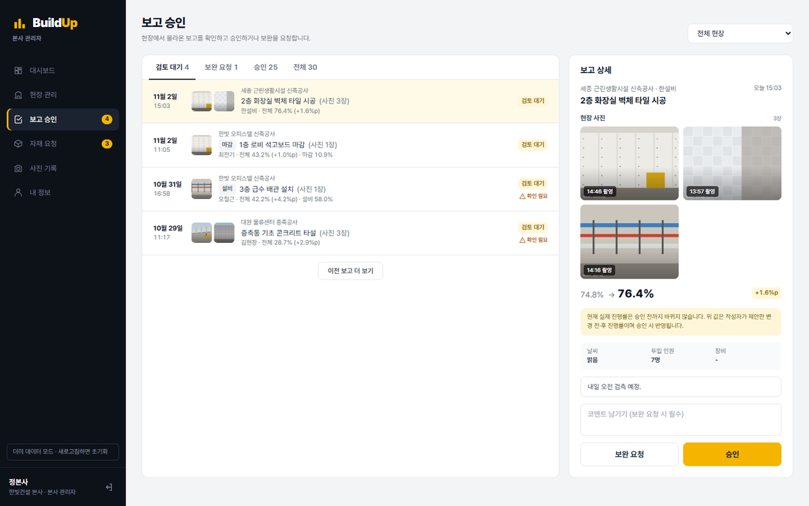
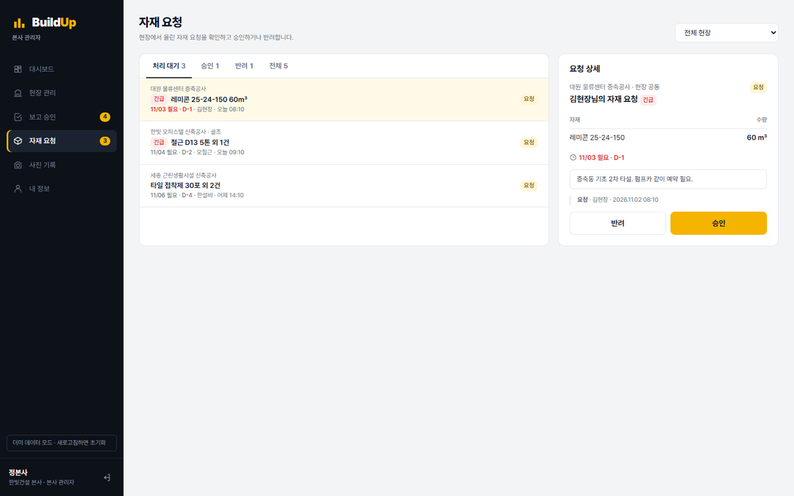
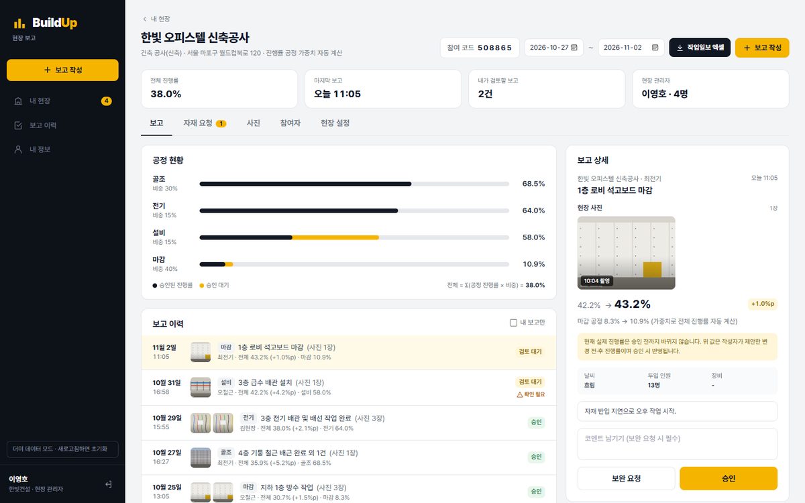
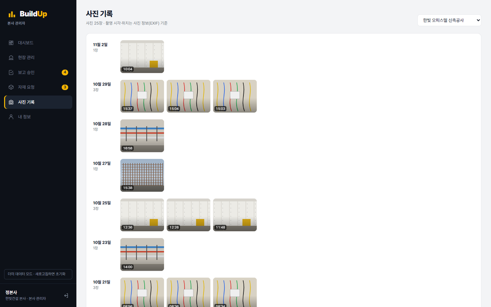
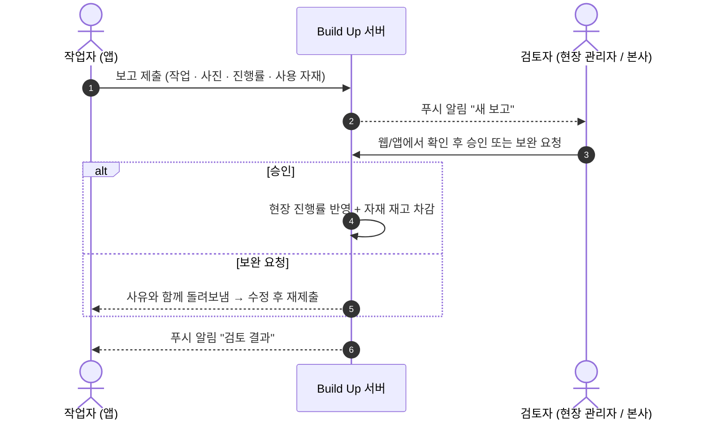
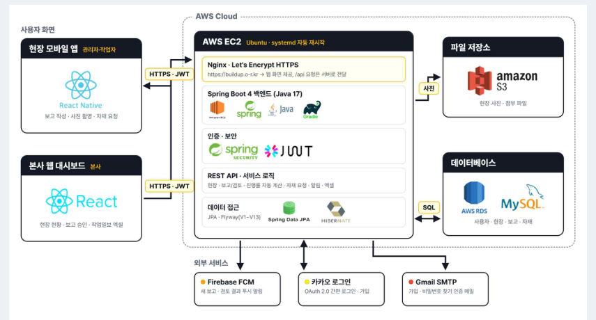

<div align="center">

# 🏗️ Build Up (빌드업)

**공사 현장 보고 · 관리 앱 / 웹 서비스**

현장은 앱으로 쉽게 보고하고, 본사는 웹 대시보드로 여러 현장을 한 화면에서 확인합니다.

[](https://buildup.o-r.kr)
[](https://github.com/lrevin/build-up/releases/download/apk-2026-10-25/BuildUp.apk)


경동대학교 컴퓨터공학과 2026학년도 졸업작품 · 팀 **B.U.**

</div>

---

## 📌 목차

1. [왜 만들었나](#-왜-만들었나)
2. [한눈에 보기](#-한눈에-보기)
3. [주요 기능](#-주요-기능)
4. [서비스 흐름](#-서비스-흐름)
5. [시스템 구성](#-시스템-구성)
6. [기술 스택](#️-기술-스택)
7. [보안 · 개인정보](#-보안--개인정보)
8. [배포 · 운영](#-배포--운영)
9. [팀 · 역할](#-팀--역할)
10. [개발 과정과 성과](#-개발-과정과-성과)
11. [저장소 구조 · 실행 방법](#-저장소-구조--실행-방법)

---

## 💡 왜 만들었나

건설 현장 보고는 지금도 대부분 **카카오톡 단체방 + 전화 + 엑셀**로 이루어집니다.

| 지금의 문제 | 빌드업의 해결 |
|---|---|
| 사진은 메신저, 설명은 전화, 정리는 엑셀 → 같은 보고를 여러 번 | **작업 입력 → 사진 → 진행률 → 제출**, 4단계로 하루 보고 끝 |
| 메시지가 쌓여 현장이 어디까지 왔는지 모름 | 공정별 가중치로 **진행률 자동 계산**, 대시보드에서 실시간 확인 |
| 소규모 회사는 쓸 만한 도구가 없음 | 앱 설치 + 6자리 참여 코드만으로 시작 |
| 허위 · 지연 보고, 하자 분쟁 때 근거 부족 | 사진 **촬영 시각 · 위치**와 제출 위치 저장, 날짜별 기록이 자동으로 쌓임 |

> 현업 건설사 현장 실무자 인터뷰로 필요성을 확인했습니다. (보고 시간 단축 · 허위 보고 방지 · 공정 증빙 · 소규모 회사 수요)

---

## 👀 한눈에 보기

### 📱 현장 앱 (작업자 · 현장 관리자)

| 내 현장 | 하루 보고 작성 | 진척 현황 |
|:---:|:---:|:---:|
|  |  |  |

### 🖥️ 웹 대시보드 (본사 · 현장 관리자)

**현장 대시보드** — 여러 현장의 진행률, 공정 현황, 최근 보고를 한 화면에



<details>
<summary><b>화면 더 보기 (보고 승인 · 자재 요청 · 현장 상세 · 사진 기록)</b></summary>

**보고 승인** — 사진과 진행률 변화를 보고 승인 / 보완 요청



**자재 요청** — 현장에서 올린 요청을 승인 / 반려



**현장 상세 (현장 관리자)** — 보고 · 자재 · 사진 · 참여자 · 현장 설정



**사진 기록** — 날짜별 현장 사진 타임라인



</details>

---

## ✨ 주요 기능

| 구분 | 기능 |
|---|---|
| **계정** | 이메일 · 휴대폰 인증 가입, 카카오 로그인, 역할 선택(작업자 / 현장 관리자 / 본사), 약관 동의, 비밀번호 찾기 · 변경, 탈퇴(7일 유예 · 재가입 시 복구) |
| **현장** | 현장 생성, **6자리 참여 코드**로 참여, 공정 · 가중치 설정, 현장 위치, 본사 연결, 참여자 관리 |
| **보고** | 작업 내용 · 사진(작업 전 / 후) · 공정 진행률 · 사용 자재 · 첨부 파일, 작성 중 임시 저장, 사진 EXIF(촬영 시각 · 위치) 자동 읽기 |
| **검토** | 승인 / 보완 요청 → 재제출, **승인된 보고만 진행률 · 재고에 반영**, 작업 평점(0.5~5.0), 현장에서 1km 넘게 떨어진 제출 표시 |
| **자재** | 현장 재고 등록, 자재 요청 → 승인 / 반려, 승인 시 사용량 자동 차감 |
| **확인** | 진행률 추이 그래프, 사진 타임라인, 작업일보 엑셀 내려받기, 푸시 알림 |

---

## 🔄 서비스 흐름



- **검토자**: 본사에 연결된 현장은 본사, 아니면 현장 관리자(최고 책임자)
- **현장 참여**: 현장 관리자가 현장을 만들면 6자리 코드 발급 → 작업자가 코드로 참여

---

## 🧩 시스템 구성



앱과 웹이 **하나의 서버 · 하나의 DB**를 함께 쓰기 때문에, 현장에서 올린 보고가 곧바로 대시보드에 나타나고 검토 결과도 바로 앱으로 돌아갑니다.

---

## 🛠️ 기술 스택

| 영역 | 기술 | 쓰임 |
|---|---|---|
| 앱 | React Native 0.87 · TypeScript · React Navigation · AsyncStorage | 현장용 안드로이드 앱(카메라 · 위치 · 알림), 임시 저장 |
| 웹 | React 19 · Vite · Tailwind CSS v4 · TanStack Query · React Router v7 | 본사 · 현장 관리자 대시보드, 서버 데이터 캐시 · 자동 새로 고침 |
| 서버 | Java 17 · Spring Boot 4 · Spring Data JPA · Flyway · JUnit | 앱 · 웹 공용 REST API, DB 버전 관리(V1~V15), API 흐름 테스트 |
| 인증 · 보안 | Spring Security · JWT(HS256) · BCrypt · SHA-256 | 접근 토큰 60분 + 리프레시 토큰 30일, 역할별 권한 |
| 데이터 | AWS RDS(MySQL 8) · AWS S3 | 사용자 · 현장 · 보고 데이터, 비공개 사진 · 파일 저장소 |
| 인프라 | AWS EC2 · Nginx · Let's Encrypt · systemd · GitHub Actions | HTTPS 배포, 자동 재시작 · 상태 검사, 자동 검사 · APK 릴리스 |
| 외부 | Firebase Cloud Messaging · Gmail SMTP · 솔라피 · 카카오 로그인 · metadata-extractor | 푸시 알림, 인증 메일 · 문자, 간편 로그인, 사진 EXIF |

---

## 🔐 보안 · 개인정보

- **비밀번호**: BCrypt 해시로만 저장(원문 복원 불가)
- **토큰**: 접근 토큰은 JWT(HS256 서명), 리프레시 토큰은 서버에 **SHA-256 해시만** 저장 → DB가 유출돼도 로그인 불가
- **권한**: 역할 · 현장 소속을 서버에서 매 요청마다 확인, 응답에 `canEdit` · `canApprove` 같은 권한 정보를 담아 앱 · 웹이 같은 판단 사용
- **파일**: S3는 비공개, 로그인한 사용자에게만 몇 시간짜리 임시 주소 제공
- **통신**: 전 구간 HTTPS
- **개인정보**: 가입 시 만 14세 이상 · 이용약관 · 개인정보 동의 저장, [이용약관](https://buildup.o-r.kr/terms) · [개인정보 처리방침](https://buildup.o-r.kr/privacy) 공개, 탈퇴 7일 뒤 자동 삭제
- 출시 전 점검 20개 항목: [`docs/출시_전_점검표.md`](docs/출시_전_점검표.md)

---

## 🚀 배포 · 운영

- **웹 · API**: `https://buildup.o-r.kr` (EC2 + Nginx, Let's Encrypt HTTPS)
- **꺼지지 않는 서버**: systemd 자동 재시작 + 1분 간격 상태 검사(멈추면 재시작) + 스왑 + RDS 자동 백업 → [`api/server/deploy/`](api/server/deploy)
- **앱 배포**: [GitHub Releases](https://github.com/lrevin/build-up/releases)에 서버 주소가 들어간 APK 배포, CBT 진행

---

## 👥 팀 · 역할

| 이름 | 역할 | 맡은 일 |
|---|---|---|
| **이재빈** | 팀장 · 앱 | React Native 현장 앱 개발, 전체 일정 · 통합 관리 |
| **김창원** | 서버 · DB · 배포 | DB 설계 검토, AWS 배포 · 운영, 푸시 알림(FCM) |
| **강건우** | 웹 | 본사용 웹 대시보드 개발, 서버 연동 |
| **김주안** | 발표 · 자료 조사 | 자료 조사, 발표 자료, 시연 시나리오 |

---

## 📈 개발 과정과 성과

| 주차 | 기간 | 주요 작업 |
|---|---|---|
| 1주차 | 9/28 ~ 10/5 | AWS EC2 · RDS 구축, 서버 · 앱 구조 설계, 오류 응답 형식 통일 |
| 2주차 | 10/6 ~ 10/12 | Spring Security · JWT, 공사 현장 관리로 방향 확장, 현장 추가 · 보고 화면 |
| 3주차 | 10/13 ~ 10/19 | 공정 가중치 진행률 자동 계산, 앱 · 웹 · 서버 형식 통일, 본사 대시보드 |
| 4주차 | 10/20 ~ 10/26 | 가입 인증 · 카카오 로그인 · 푸시 알림, Flyway 적용, AWS 실제 배포 |
| 5주차 | 10/27 ~ 11/2 | HTTPS 도메인, 탈퇴 · 비밀번호 찾기, CBT 의견 반영(승인 후 진행률 · 평점 · 자재 재고), 약관 · 개인정보, 최종 APK |

**성과**
- 실제 사용자 테스트(CBT)를 거쳐 의견을 기능으로 반영
- 최종 발표에서 좋은 평가를 받았고, 현업 건설사로부터 후속 연락을 받았습니다

---

## 📂 저장소 구조 · 실행 방법

| 폴더 | 내용 |
| --- | --- |
| [`app-project/`](app-project) | 모바일 앱 **전체 프로젝트**(실행용) |
| [`app/`](app) | 앱 핵심 코드만 모아 본 것 |
| [`web/`](web) | 웹 대시보드 |
| [`api/`](api) | API 서버(Spring Boot) · 운영 설정(`api/server/deploy`) |
| [`database/`](database) | DB 설계 · 마이그레이션 SQL |
| [`fcm/`](fcm) | 푸시 알림(FCM) 코드 모음과 설정 방법 |
| [`docs/`](docs) | [API 약속](docs/API_약속.md), 점검표, 발표 자료 |

```bash
# 서버 (Java 17)
cd api/server && ./gradlew bootRun

# 웹 (서버 없이 더미 데이터로 보려면 VITE_USE_DUMMY=true)
cd web && npm install && npm run dev

# 앱 (Android)
cd app-project && npm install && npx react-native run-android
```

자세한 설정은 각 폴더의 README를 참고하세요.
