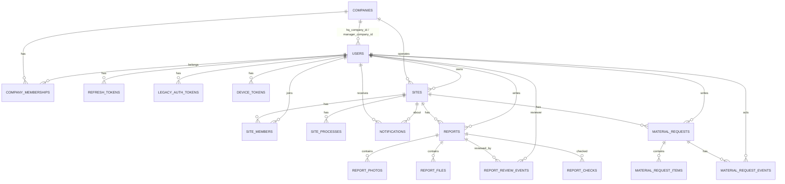

# BuildUp Database ERD (V1~V9 기준)

이 문서는 **BuildUp 백엔드의 Flyway V1~V9** 기준 최신 DB 구조를 AI/팀원 협업용으로 정리한 ERD 문서입니다.

- 기준 마이그레이션: `V1__create_initial_schema.sql` ~ `V9__align_schema_with_mobile_app.sql`
- 목적: 테이블 관계, 핵심 컬럼, 앱/백엔드 협업 이해
- 주의: 정확한 타입/제약/인덱스는 각 migration SQL 파일을 기준으로 확인

---

## 1) 핵심 구조 요약

큰 구조는 아래 4개 영역으로 나뉩니다.

1. **사용자 · 조직 · 인증**
   - `users`, `companies`, `company_memberships`
   - `refresh_tokens`, `legacy_auth_tokens`, `device_tokens`

2. **현장 · 공정**
   - `sites`, `site_members`, `site_processes`, `notifications`

3. **보고서**
   - `reports`, `report_photos`, `report_files`, `report_review_events`, `report_checks`

4. **자재**
   - `material_requests`, `material_request_items`, `material_request_events`

---

## 2) Mermaid ERD

---

## 3) 테이블별 핵심 컬럼

### users
- PK: `id`
- 주요 컬럼: `name`, `email`, `phone`, `role`, `company`, `password_hash`, `created_at`
- 회사 참조: `hq_company_id`, `manager_company_id`

### companies
- PK: `id`
- 주요 컬럼: `name`, `code`, `created_at`

### company_memberships
- PK: `id`
- FK: `company_id -> companies.id`, `user_id -> users.id`
- 주요 컬럼: `role`, `status`, `joined_at`

### refresh_tokens
- PK: `id`
- FK: `user_id -> users.id`
- 주요 컬럼: `token_hash`, `expires_at`, `revoked_at`, `created_at`

### legacy_auth_tokens
- PK: `token`
- FK: `user_id -> users.id`
- 초기 인증 구조 보존용

### device_tokens
- PK: `id`
- FK: `user_id -> users.id`
- 주요 컬럼: `token`, `updated_at`

### sites
- PK: `id`
- FK: `owner_id -> users.id`, `company_id -> companies.id`
- 주요 컬럼: `name`, `address`, `work_type`, `code`, `created_at`, `latitude`, `longitude`

### site_members
- PK: `id`
- FK: `site_id -> sites.id`, `user_id -> users.id`
- 주요 컬럼: `member_role`, `status`, `joined_at`
- UNIQUE: `(site_id, user_id)`

### site_processes
- PK: `id`
- FK: `site_id -> sites.id`
- 주요 컬럼: `process_key`, `name`, `weight`, `progress`, `last_reported_at`, `plan_start`, `plan_end`, `sort_order`
- UNIQUE: `(site_id, process_key)`

### notifications
- PK: `id`
- FK: `user_id -> users.id`, `site_id -> sites.id`
- 주요 컬럼: `type`, `title`, `message`, `reference_type`, `reference_id`, `read_at`, `created_at`

### reports
- PK: `id`
- FK: `site_id -> sites.id`, `author_id -> users.id`
- 주요 컬럼:
  - 공정 관련: `process_key`, `process_name` *(V9부터 NULL 가능)*
  - 작업 관련: `work`, `from_progress`, `to_progress`, `memo`, `weather`, `workers`, `equipment`
  - 제출 위치: `submit_latitude`, `submit_longitude`, `submit_accuracy`
  - 검토 상태: `review_status`
  - 시간: `created_at`, `updated_at`

### report_photos
- PK: `id`
- FK: `report_id -> reports.id`
- 주요 컬럼: `position`, `file_name`, `s3_key`, `original_name`, `content_type`, `size_bytes`, `taken_at`, `latitude`, `longitude`, `created_at`
- 비고: `file_name`은 기존 호환용, `s3_key`는 S3 객체 키 저장용
- UNIQUE: `(report_id, position)`, `s3_key`

### report_files
- PK: `id`
- FK: `report_id -> reports.id`
- 주요 컬럼: `position`, `path`, `s3_key`, `original_name`, `content_type`, `size_bytes`, `created_at`
- 비고: `path`는 기존 호환용, `s3_key`는 S3 객체 키 저장용
- UNIQUE: `(report_id, position)`, `s3_key`

### report_review_events
- PK: `id`
- FK: `report_id -> reports.id`, `reviewer_id -> users.id`
- 주요 컬럼: `status`, `comment`, `created_at`

### report_checks
- PK: `id`
- FK: `report_id -> reports.id`
- 주요 컬럼: `position`, `check_type`, `message`, `created_at`
- UNIQUE: `(report_id, position)`
- 비고: 보고 제출 시 검사 결과 보존용

### material_requests
- PK: `id`
- FK: `site_id -> sites.id`, `author_id -> users.id`
- 주요 컬럼: `process_key`, `process_name` *(V9부터 NULL 가능)*, `needed_by`, `urgent`, `note`, `status`, `reject_reason`, `created_at`

### material_request_items
- FK: `request_id -> material_requests.id`
- 주요 컬럼: `position`, `name`, `quantity`, `unit`
- UNIQUE: `(request_id, position)`

### material_request_events
- FK: `request_id -> material_requests.id`, `actor_user_id -> users.id`
- 주요 컬럼: `position`, `status`, `actor`, `by_hq`, `at`
- UNIQUE: `(request_id, position)`

---

## 4) V9에서 반영된 핵심 변경

### 앱 구조 반영
- `sites.work_type` 추가
- `sites.latitude`, `sites.longitude` 추가
- `reports.work` 추가
- `reports.submit_latitude`, `submit_longitude`, `submit_accuracy` 추가
- `reports.process_key`, `process_name` → NULL 허용
- `material_requests.process_key`, `process_name` → NULL 허용

### S3 메타데이터 반영
- `report_photos`
  - `id`, `s3_key`, `original_name`, `content_type`, `size_bytes`, `taken_at`, `latitude`, `longitude`, `created_at`
- `report_files`
  - `id`, `s3_key`, `content_type`, `created_at`
- 원칙: **DB에는 S3 URL이 아니라 `s3_key`만 저장**

### 검사 결과 보존
- 신규 테이블 `report_checks` 추가

---

## 5) AI/팀원 참고 포인트

### 저장값 / 계산값 / JOIN값 구분
앱 화면에 보이는 모든 값을 DB 컬럼으로 만들 필요는 없습니다.

#### 저장값 예시
- `reports.work`
- `sites.work_type`
- `report_photos.s3_key`

#### JOIN값 예시
- `ownerName` → `sites.owner_id -> users.name`
- `reviewerName` → `report_review_events.reviewer_id -> users.name`

#### 계산값 예시
- `memberCount` → `site_members` COUNT
- `pendingReviews` → `reports` 중 `review_status='PENDING'` 개수
- `reportCount` → `reports` COUNT

#### 권한 계산값 예시
- `canEdit`, `canDelete`, `canReview`
- 현재 사용자 역할 + 데이터 상태를 조합해 API 응답에서 계산

---

## 7) 주의사항

- `build-up-erd.md`는 **구조 설명용 문서**이며, 정확한 실행 스키마는 반드시 Flyway SQL 기준으로 확인
- `.env`, RDS 비밀번호, AWS 키 같은 민감정보는 포함하지 않음
- 실제 API 구현 시 필요한 집계값/권한값은 Service/DTO 계층에서 계산
