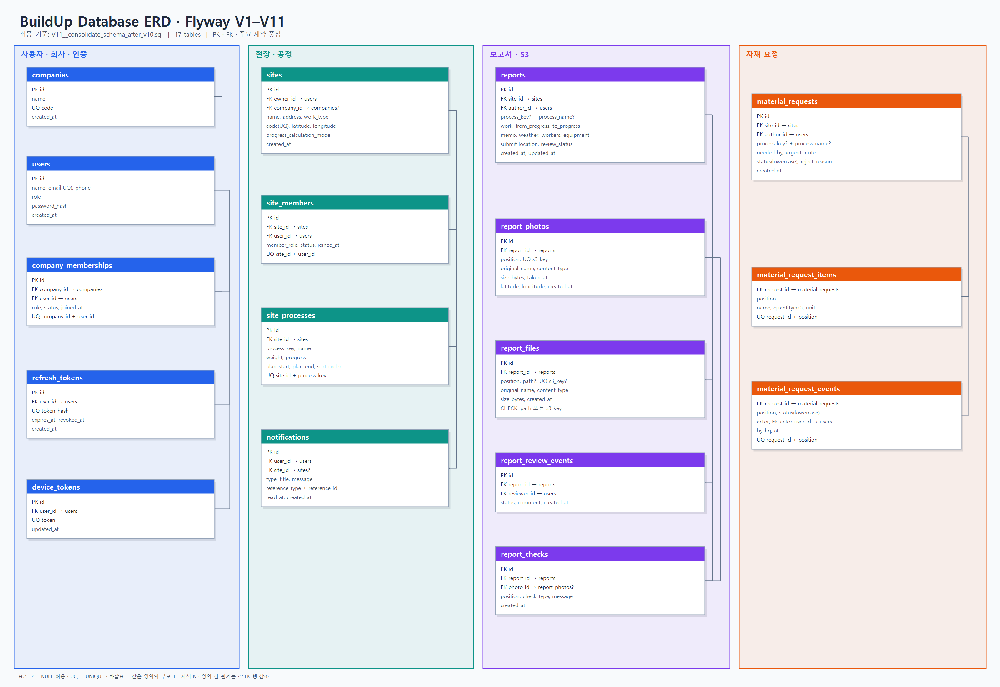
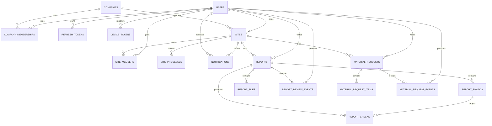

# BuildUp Database ERD (V1~V11)

이 문서는 `V1__create_initial_schema.sql`부터 `V11__consolidate_schema_after_v10.sql`까지 적용한 현재 구조를 설명합니다. 정확한 타입과 제약조건은 `database/migrations/`의 SQL을 기준으로 확인합니다.

## 관계 구조

## V11 기준 핵심 사항

- 회사 소속은 `company_memberships`로 통합됐으며 `users`의 레거시 회사 컬럼과 `legacy_auth_tokens`는 제거됐습니다.
- 현장은 `progress_calculation_mode`로 공정 가중치 자동 계산과 직접 입력 방식을 구분합니다.
- 보고서 사진과 첨부파일은 S3 객체 키와 메타데이터를 저장하며, 사진의 구형 `file_name` 컬럼은 제거됐습니다.
- `report_checks.photo_id`로 특정 사진에 관한 검사 결과를 연결할 수 있습니다.
- 자재 요청 본문과 이벤트 상태는 `requested`, `approved`, `rejected`, `ordered`, `delivered` 소문자로 저장합니다.

## 테이블 영역

- 사용자·회사·인증: `users`, `companies`, `company_memberships`, `refresh_tokens`, `device_tokens`
- 현장·공정: `sites`, `site_members`, `site_processes`, `notifications`
- 보고서·S3: `reports`, `report_photos`, `report_files`, `report_review_events`, `report_checks`
- 자재 요청: `material_requests`, `material_request_items`, `material_request_events`
